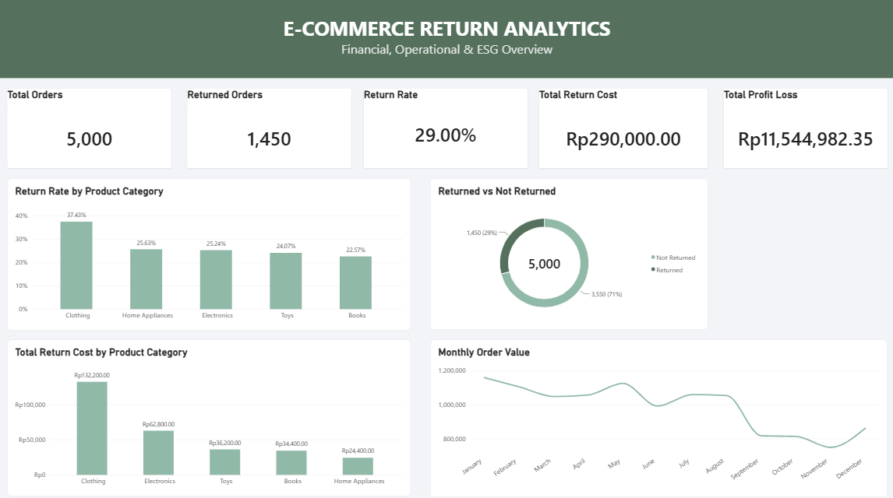
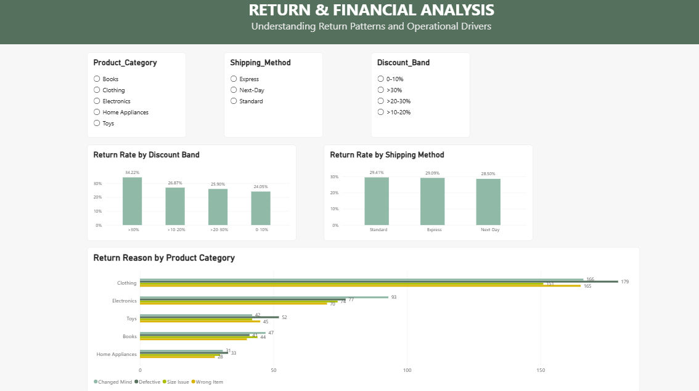
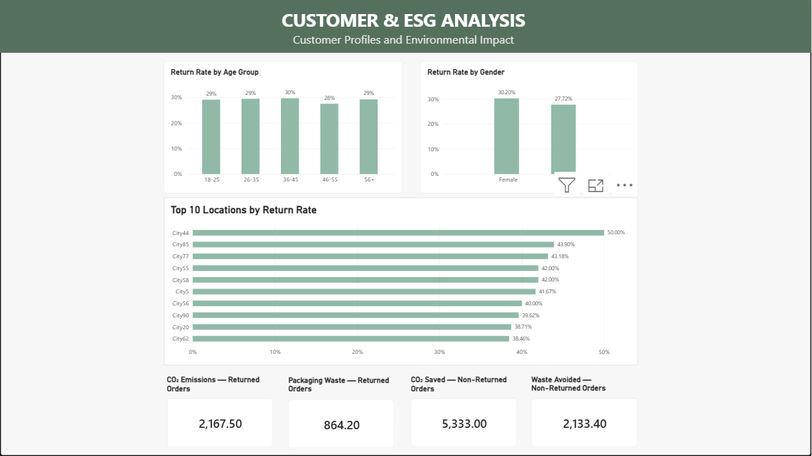

# E-Commerce Return Analytics

### Financial, Operational & ESG Insights

## 📌 Tentang Proyek

Proyek ini menganalisis data transaksi e-commerce untuk memahami pola retur, dampak finansial dan operasional, karakteristik pelanggan, serta dampak lingkungan yang berkaitan dengan proses retur.

Analisis dilakukan menggunakan Microsoft Excel, Power Query, Power BI, dan DAX dengan dataset synthetic e-commerce returns yang terdiri dari 5.000 transaksi.

---

## 🎯 Tujuan Analisis

Proyek ini bertujuan untuk menjawab beberapa pertanyaan bisnis:

1. Kategori produk mana yang memiliki Return Rate dan total biaya retur tertinggi?
2. Apakah tingkat diskon dan metode pengiriman berkaitan dengan tingkat retur yang lebih tinggi?
3. Apa alasan retur utama pada tiap kategori produk?
4. Berapa CO₂ Emissions dan Packaging Waste yang berkaitan dengan pesanan yang dikembalikan?
5. Bagaimana profil demografi pelanggan yang melakukan retur?
6. Berapa CO₂ Saved dan Waste Avoided dari pesanan yang tidak dikembalikan?

---

## 🗂️ Dataset

Dataset yang digunakan merupakan **Synthetic E-Commerce Returns Dataset** dengan:

- **5.000 transaksi**
- **23 kolom utama**
- Informasi transaksi, produk, pelanggan, retur, biaya, profit/loss, dan metrik lingkungan

Beberapa variabel utama:

- Order ID
- Product Category
- Product Price
- Order Quantity
- Discount Applied
- Shipping Method
- User Age
- User Gender
- User Location
- Return Status
- Return Reason
- Return Cost
- Profit/Loss
- CO₂ Emissions
- Packaging Waste
- CO₂ Saved
- Waste Avoided

---

## 🛠️ Tools & Technologies

- **Microsoft Excel** — data inspection, cleaning, dan exploratory analysis
- **Power Query** — data transformation dan perbaikan format numerik
- **Power BI** — dashboard dan data visualization
- **DAX** — pembuatan measures dan calculated columns

---

## 🔄 Data Preparation & Analysis Process

### 1. Data Cleaning

Melakukan pengecekan kualitas data untuk memastikan data siap dianalisis, meliputi:

- Checking missing values
- Checking duplicate Order ID
- Checking data types
- Perbaikan format numerik dan decimal separator
- Validasi format tanggal

### 2. Data Preparation

Membuat beberapa variabel tambahan untuk mendukung analisis:

- Age Group
- Discount Band
- Month
- Return Flag

### 3. Data Analysis

Analisis dilakukan berdasarkan:

- Product Category
- Discount Band
- Shipping Method
- Return Reason
- Customer Demographics
- Financial Impact
- Environmental Impact

### 4. Dashboard Development

Membangun interactive dashboard menggunakan Power BI yang terdiri dari tiga halaman:

**Page 1 — Executive Overview**
- Total Orders
- Returned Orders
- Return Rate
- Total Return Cost
- Total Profit/Loss
- Monthly Order Value
- Return Rate by Product Category
- Returned vs Not Returned

**Page 2 — Return & Financial Analysis**
- Return Rate by Discount Band
- Return Rate by Shipping Method
- Return Reason by Product Category
- Interactive filters

**Page 3 — Customer & ESG Analysis**
- Return Rate by Age Group
- Return Rate by Gender
- Top 10 Locations by Return Rate
- CO₂ Emissions
- Packaging Waste
- CO₂ Saved
- Waste Avoided

---

## 📊 Key Insights

1. Kinerja Retur Secara Keseluruhan

Dari total 5.000 pesanan, terdapat 1.450 pesanan yang dikembalikan, sehingga menghasilkan tingkat retur (Return Rate) sebesar 29%. Hasil ini menunjukkan bahwa hampir 3 dari 10 pesanan dalam dataset berstatus retur.

2. Kategori Produk

Kategori Clothing memiliki tingkat retur tertinggi sebesar 37,43%, dengan total biaya retur sebesar Rp132.200. Kategori ini menjadi salah satu prioritas untuk ditinjau lebih lanjut karena memiliki tingkat retur dan biaya retur yang menonjol dibandingkan kategori lainnya.

3. Pola Retur Berdasarkan Diskon

Kelompok transaksi dengan diskon di atas 30% memiliki tingkat retur sebesar 34,22%, lebih tinggi dibandingkan tingkat retur keseluruhan sebesar 29%. Pola ini menunjukkan adanya keterkaitan antara kelompok diskon tinggi dan tingkat retur yang lebih tinggi pada dataset, tetapi belum membuktikan bahwa diskon menyebabkan retur.

4. Pola Retur Berdasarkan Metode Pengiriman

Tingkat retur berdasarkan metode pengiriman relatif berdekatan:

Standard: 29,41%

Express: 29,09%

Next Day: 28,50%

Selisih antar-metode pengiriman relatif kecil. Berdasarkan hasil deskriptif ini, belum terlihat perbedaan tingkat retur yang besar berdasarkan metode pengiriman.

5. Alasan Retur

Alasan retur yang paling sering tercatat adalah:

Defective: 382 pesanan

Changed Mind: 379 pesanan

Wrong Item: 348 pesanan

Size Issue: 341 pesanan

Alasan Defective dan Changed Mind memiliki jumlah yang paling tinggi. Temuan ini dapat menjadi dasar untuk mengevaluasi kualitas produk, kejelasan informasi produk, serta kesesuaian ekspektasi pelanggan.

6. Karakteristik Pelanggan

Tingkat retur antar-kelompok usia relatif stabil, dengan nilai yang berada di kisaran sekitar 28%–30%.

Berdasarkan gender, tingkat retur pelanggan perempuan sebesar 30,20%, sedangkan pelanggan laki-laki sebesar 27,72%. Perbedaan ini bersifat deskriptif dan belum cukup untuk menyimpulkan bahwa gender merupakan faktor penyebab retur.

7. Indikator Dampak Lingkungan

Dashboard mencatat indikator lingkungan berikut:

Pada pesanan yang dikembalikan:

CO₂ Emissions: 2.167,50

Packaging Waste: 864,20

Pada pesanan yang tidak dikembalikan:

CO₂ Saved: 5.333,00

Waste Avoided: 2.133,40

Nilai tersebut menggambarkan indikator lingkungan yang tersedia dalam dataset. Interpretasi lebih lanjut perlu mempertimbangkan satuan, definisi, dan metode perhitungan setiap metrik.

## 💡 Rekomendasi Bisnis

Berdasarkan temuan analisis, beberapa rekomendasi yang dapat dipertimbangkan adalah:

Evaluasi kategori Clothing. Tinjau kualitas produk, informasi ukuran, foto dan deskripsi produk, serta pola retur untuk mengidentifikasi area yang perlu diperbaiki.

Tinjau transaksi dengan diskon tinggi. Analisis lebih lanjut kelompok diskon di atas 30% berdasarkan kategori produk, alasan retur, dan karakteristik transaksi untuk memahami pola yang mendasarinya.

Perkuat pengendalian kualitas produk. Karena Defective merupakan alasan retur dengan jumlah tertinggi, evaluasi proses pemeriksaan produk sebelum pengiriman dapat menjadi langkah tindak lanjut.

Evaluasi akurasi pemenuhan pesanan. Tinjau proses pengambilan, pengepakan, dan pengiriman barang untuk mengidentifikasi potensi kesalahan yang berkaitan dengan alasan Wrong Item.

Gunakan segmentasi pelanggan sebagai dasar eksplorasi. Perbedaan tingkat retur berdasarkan gender dan kelompok usia dapat diteliti lebih lanjut bersama kategori produk dan alasan retur sebelum menentukan tindakan yang lebih spesifik.

Pantau indikator lingkungan. Gunakan metrik CO₂ dan limbah kemasan untuk memantau potensi dampak lingkungan, dengan memastikan definisi dan satuan pengukuran telah tervalidasi.

## Catatan Interpretasi

Analisis ini bersifat deskriptif dan bertujuan mengidentifikasi pola dalam dataset. Temuan tidak secara langsung membuktikan hubungan sebab-akibat. Rekomendasi di atas merupakan usulan tindak lanjut yang perlu dievaluasi lebih lanjut menggunakan data dan konteks operasional yang relevan.

---

## 📊 Dashboard

Dashboard interaktif dikembangkan menggunakan Power BI untuk menganalisis pola retur produk, dampak finansial, faktor operasional, karakteristik pelanggan, dan indikator dampak lingkungan.

### Halaman 1 — Ringkasan Eksekutif

Menampilkan gambaran umum kinerja transaksi dan retur, meliputi jumlah pesanan, tingkat retur, biaya retur, estimasi kerugian laba, serta tren nilai pesanan bulanan dan tingkat retur berdasarkan kategori produk.



### Halaman 2 — Analisis Retur dan Finansial

Menganalisis tingkat retur berdasarkan kelompok diskon dan metode pengiriman, serta membandingkan alasan retur pada setiap kategori produk untuk mengidentifikasi area yang berpotensi memerlukan perbaikan operasional.



### Halaman 3 — Analisis Pelanggan dan ESG

Menganalisis pola retur berdasarkan kelompok usia, gender, dan lokasi pelanggan, serta menampilkan indikator dampak lingkungan berupa emisi CO₂, limbah kemasan, CO₂ yang dihemat, dan limbah yang dihindari.



## 📂 Akses File Proyek

File pendukung proyek dapat diakses melalui tautan berikut:

- **[Lihat File Power BI (.pbix)](powerbi/Return_Analytics.pbix)** — file dashboard untuk dibuka menggunakan Microsoft Power BI Desktop.
- **[Lihat Dataset yang Telah Dibersihkan](data/returns_cleaned.xlsx)** — dataset hasil persiapan data yang digunakan dalam analisis.
- **[Lihat Dataset CSV](data/returns_sustainability_dataset.csv)** — dataset CSV pendukung analisis.

## 📁 Struktur Proyek

```text
ecommerce-return-analytics/
├── README.md
├── data/
│   ├── returns_cleaned.xlsx
│   └── returns_sustainability_dataset.csv
├── powerbi/
│   └── Return_Analytics.pbix
├── images/
│   ├── overview-dashboard.png
│   ├── return-drivers.png
│   └── customer-esg.png
└── documentation/
    ├── PORTOFOLIO AURORA 2026.pdf
```
